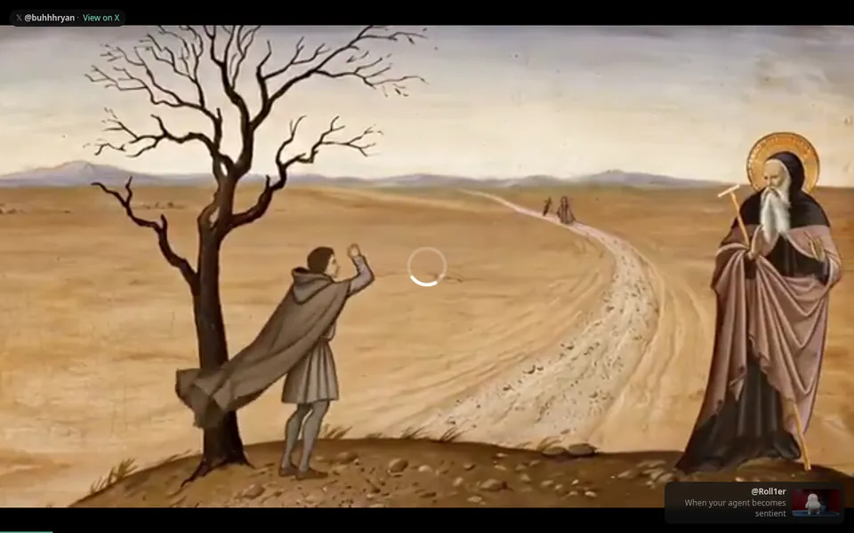
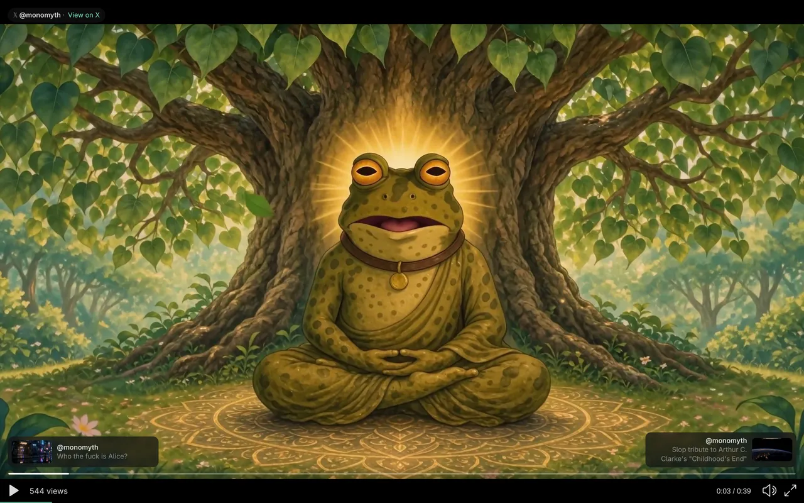

# slopTV

A keyboard-driven player for the Slop Cannon feed on [Omarchy](https://omarchy.org/). One shortcut opens a window that plays the curated posts from [jon-slop.grok.me](https://jon-slop.grok.me) one after another, video only, and moves on by itself.


## Terms of service and your responsibility

Read this before you install.

- slopTV is an unofficial hobby project. It is **not affiliated with, endorsed by or sponsored by X**, and it is **not submitted as an official Omarchy plugin**.
- The default player loads `https://x.com/i/videos/tweet/<id>`, an **undocumented X page**. X may change it, put it behind a login, or block it at any time. X's terms for third-party apps that display posts are not entirely clear on a use like this, and nobody here has asked X.
- slopTV does **not show all the display elements X's rules require** for displaying Posts (avatar, post text, linked timestamp, action icons). It shows a small attribution pill with the X mark as text, @handle, creator name when the feed has one, and a "View on X" link. See X's Display Requirements.
- The most conservative option is the official embed: set `player = "embed"` in the config. That shows X's own embedded Post, unmodified. It is the closest to what X documents, but it is still your call whether the way slopTV wraps it fits the rules.
- The hidden raw mode streams video files directly from `video.twimg.com` and may violate X's terms.
- Using this software, and complying with X's [Terms of Service](https://x.com/en/tos), [Developer Agreement](https://docs.x.com/developer-terms/agreement), [Developer Policy](https://docs.x.com/developer-terms/policy), [Display Requirements](https://docs.x.com/developer-terms/display-requirements) and the rights of the creators whose videos you watch, is **entirely your responsibility**. Use it at your own risk. The authors give no warranty (see the MIT license).

## What it does

- Fetches a list of post IDs (with creator, caption, duration, poster) from `jon-slop.grok.me/videos.json`.
- Opens a Chromium app window, with a private profile, that shows X's video page for the current post, filling the window. Nothing else is drawn by default.
- Moves to the next post when the clip's known duration (plus 1 s) has passed, never looping a single clip, and wraps to the first only after the end of the list.
- Shows small previous/next cards and an attribution pill when you move the mouse, pause, or a new clip starts.

| Cards and attribution (mouse moved) | Paused (cards stay visible) |
|---|---|
|  |  |

Screenshots were taken in Chromium under Xvfb, not on Hyprland.

## How it works

1. A small Rust program (the controller) loads the feed, keeps the queue (next, previous, shuffle) and serves a local page on `127.0.0.1` with a random token in the URL.
2. It starts Chromium (`--app`, `--class=slop-tv` (X11 only; on Wayland Chromium names the window `chrome-__tmp_slop-tv-launch-<pid>.html-Default`, which slopTV matches by the `slop-tv` substring), private profile under `~/.cache/omarchy/sloptv/chromium-profile/`, `--autoplay-policy=no-user-gesture-required`, fullscreen by default). The page holds one iframe with X's page, with `allow="autoplay; fullscreen"`.
3. **Auto-advance is timer-based.** The iframe is cross-origin, so slopTV cannot see when a video ends and it injects nothing into X's page. Every record in the live feed carries `duration_ms` (checked: 594 of 594); the countdown is that duration rounded up plus 1 s. A post with no known duration waits for you (or uses `embed_default_secs`).
4. **Pause.** `p`/Space freezes slopTV's countdown; resume continues from the remaining time. A click inside the video does not pause or stop the countdown; only `p`/Space does, and the countdown does not depend on keyboard focus.
5. The cards, the pill and the 2 px progress line at the bottom edge are our own elements on our own page.

### Player modes

| mode | how | notes |
|---|---|---|
| video page (default) | `player = "video"` | X's undocumented video-only page, `?autoplay=1` (also undocumented). Falls back to the embed if the page is unreachable (see Troubleshooting). |
| official embed | `player = "embed"` | X's official embedded Post (`platform.twitter.com/embed/Tweet.html?id=<id>&dnt=true&theme=dark`), unmodified, centered. Shows the full card. Not video-only. |
| raw mpv (hidden) | `--raw-mpv` or `raw_mpv = true` | Streams the mp4 through libmpv. Not shown in `--help`. See Advanced. |

Optional hidden embed settings (`embed_use_widgets`, `embed_scale_to_fit`) and the research behind the design are in [docs/EMBED_NOTES.md](docs/EMBED_NOTES.md).

### Keys

| key | action |
|---|---|
| l / Right / n | next post |
| h / Left | previous post |
| p / Space | pause / resume our auto-advance timer |
| a | auto-advance on/off |
| s | shuffle on/off (default on) |
| f | like: opens `https://x.com/intent/like?tweet_id=<id>` in your default browser; you confirm on X with your own login |
| o | open the post on X in your default browser (`xdg-open`). Public posts open without an account, but X may show a login wall when signed out |
| w or F11 | toggle fullscreen |
| d | debug overlay (top right): current id, feed duration, seconds remaining, paused, auto-advance, position, focused element. Hidden by default |
| q | quit |

Mouse: move to show the cards; click a card to jump; double-click a screen edge strip to toggle fullscreen. Keys only reach our page while it has focus; see Troubleshooting.

Global chords (set up by the install script, work whatever has focus): **Super+Shift+Ctrl+T** starts, focuses or closes the player; **Super+Shift+Ctrl+F** toggles fullscreen of the player window through Hyprland. The bar icon does the same as the first chord.

## Install

```sh
omarchy plugin add https://github.com/monomyth/omarchy-sloptv.git --enable --yes
bash ~/.config/omarchy/plugins/io.github.monomyth.sloptv/scripts/install.sh
```

`--yes` skips Omarchy's left/center/right prompt, so the bar icon lands on the right. Move it later with `omarchy plugin enable io.github.monomyth.sloptv --section left|center|right`.

`install.sh` builds the binary once with `cargo build --release` into `~/.cache/omarchy/sloptv/` (a few minutes), adds the two keybinds if the chords are free (it reports a conflict instead of overwriting), and prints a how-to-run summary. To add the binds by hand, paste `bindings.hypr.lua.example` into `~/.config/hypr/bindings.lua`.

**Requirements:** Chromium (Chrome and Brave also work), `jq`, `hyprctl`, `xdg-utils`, and for building `rust` and `pkgconf`. `mpv` is optional (raw mode only; the build leaves raw mode out if libmpv is missing).

```sh
sudo pacman -S chromium rust pkgconf jq xdg-utils
```

**Uninstall:**

```sh
bash ~/.config/omarchy/plugins/io.github.monomyth.sloptv/scripts/uninstall.sh
```

This removes the keybind blocks (backup in `bindings.lua.sloptv.bak`), stops the player and its private Chromium, deletes the binary and caches and `~/.config/slop-tv/` (`--keep-config` keeps it), then runs `omarchy plugin remove io.github.monomyth.sloptv --yes`.

**Reinstall / update:**

```sh
bash ~/.config/omarchy/plugins/io.github.monomyth.sloptv/scripts/uninstall.sh --keep-config
omarchy plugin add https://github.com/monomyth/omarchy-sloptv.git --enable --yes
bash ~/.config/omarchy/plugins/io.github.monomyth.sloptv/scripts/install.sh
```

## Config

Copy `config.example.toml` to `~/.config/slop-tv/config.toml`. All keys are optional.

| key | default | meaning |
|---|---|---|
| `player` | `"video"` | `"video"` (X video page) or `"embed"` (official embed) |
| `start_fullscreen` | `true` | open the window fullscreen. It is applied once at startup and never re-forced after you leave fullscreen |
| `auto_advance` | `true` | move on by timer after each post's duration |
| `embed_default_secs` | `0` | seconds to show a post with no known duration (0 = wait for you) |
| `shuffle` | `true` | shuffled order |
| `source_url`, `fallback_url` | jon-slop.grok.me | feed location (URL, path or `file://`) |

CLI: `slop-tv [--source URL|PATH] [--config FILE] [--cache-dir DIR] [--check] [--reset-notice]`. `--check` fetches and parses the feed and exits; `--reset-notice` shows the first-run notice again. `SLOPTV_BIN=/path/to/slop-tv` makes the launcher use that binary.

First run shows a small notice: the default page is unofficial, loads X scripts and media, and X may set cookies in slopTV's private Chromium profile (not your normal one). Nothing starts loading from X until you accept.

| thing | path |
|---|---|
| plugin | `~/.config/omarchy/plugins/io.github.monomyth.sloptv/` |
| binary | `~/.cache/omarchy/sloptv/target/release/slop-tv` |
| Chromium profile | `~/.cache/omarchy/sloptv/chromium-profile/` |
| build log | `~/.cache/omarchy/sloptv/build.log` |
| launcher log | `~/.local/state/omarchy/sloptv/slop-tv.log` |

## Troubleshooting

**Fullscreen does nothing, or you cannot get back into it.** On Hyprland, `w`, F11, a double-click on a screen edge strip and Super+Shift+Ctrl+F all ask Hyprland itself to toggle the slop-tv window (focus it by address, then `fullscreen 0`). Outside Hyprland, `w` uses the browser's Fullscreen API. slopTV only requests fullscreen once at startup. If it still fails, look at the window state:

```sh
hyprctl clients -j | jq '.[] | select(.class|test("slop-tv")) | {address, class, fullscreen, fullscreenClient, floating, workspace: .workspace.name, at, size}'
# or, with the plugin installed:
bash ~/.config/omarchy/plugins/io.github.monomyth.sloptv/scripts/open.sh status
```

On Wayland the class looks like `chrome-__tmp_slop-tv-launch-<pid>.html-Default` (pid = the slop-tv controller), not `slop-tv`; slopTV, `open.sh` and the chord match any class containing `slop-tv` and prefer the one with the controller's pid. `fullscreen` greater than 0 (2 = fullscreen) means Hyprland considers it fullscreen; the toggle (`fullscreen 0`) leaves it windowed and a second press returns. Try the toggle by hand with `bash ~/.config/omarchy/plugins/io.github.monomyth.sloptv/scripts/open.sh fullscreen` and compare the output; the launcher log is `~/.local/state/omarchy/sloptv/slop-tv.log`.

**Keys stop working after I click the video.** Clicking gives X's frame the keyboard. slopTV takes focus back about a second after a click, and also when the mouse enters a screen edge strip (22 px left/right, 14 px top). Clicking in the video does not affect the countdown.

**A play button shows and the video does not start.** The video page autoplays only because of the undocumented `?autoplay=1`. If X stops honouring it, click the video once per clip. `player = "embed"` has the same limit.

**The page does not load.** At startup slopTV makes one opaque request to the video page; if it fails (offline, DNS, blocked, 8 s timeout) the session switches to the official embed. It cannot detect an HTTP error, a login wall or an "unavailable" message inside a page that did load, and only the first clip is probed. Set `player = "embed"` to avoid the page entirely.

**The next video did not start.** Press `d` to see the countdown: if `remaining` runs down and `paused` is false, slopTV will advance when it hits 0; if `paused` is true you pressed `p`/Space (press it again); if `remaining` says `off`, auto-advance is off (`a`) or the post has no feed duration. If it advanced but the new clip shows a play button, X did not honour `?autoplay=1` for that load (we cannot read the page to confirm playback, so the countdown runs regardless; click the video once). An X error or login wall inside the frame is not detectable and also does not stop the countdown. Chromium is started with `--disable-background-timer-throttling`, `--disable-renderer-backgrounding` and `--disable-backgrounding-occluded-windows` so a covered or background window keeps its pace.

**The auto-advance changes too early or late.** It is a timer from the feed's duration plus 1 s, started when the frame loads. Slow loading, X's own pause or seek, or a post whose real video length differs from the feed all shift it. `a` turns it off.

## What it talks to

**Video page (default):**
- `jon-slop.grok.me/videos.json` (feed, ETag polling), fetched by the Rust program.
- `x.com/i/videos/tweet/<id>?autoplay=1` inside our iframe, and whatever that page loads (X scripts, `video.twimg.com`, possibly cookies in slopTV's private Chromium profile). One extra opaque `no-cors` request to the first clip's page serves as the reachability probe; its response is never read.
- `pbs.twimg.com`: poster thumbnails for the cards, plain lazy `` tags, only after you accept the notice.
- `x.com/intent/like?tweet_id=<id>` and the post URL, only through `xdg-open` when you press `f`, `o` or click "View on X".
- `127.0.0.1` on a random port with a random token: our own local page, not reachable from other machines.

**Embed (`player = "embed"`):** the same, but `platform.twitter.com/embed/Tweet.html?id=<id>&dnt=true&theme=dark` instead of the video page (and `platform.twitter.com/widgets.js` if the hidden `embed_use_widgets` is on).

**Raw mode:** `jon-slop.grok.me/videos.json`, `video.twimg.com` mp4s (libmpv) and `pbs.twimg.com` posters. No X page or API.

slopTV calls no X API, sends no cookies or credentials of its own, reads no cookies, and injects no CSS or JavaScript into X's pages. Streaming a raw mp4 is not the same as playing in X's own player, and whether X counts such plays as views is undocumented and untested.

## Data source

Default: `https://jon-slop.grok.me/videos.json` (newest first, ETag, re-checked every 60 min with `If-None-Match`, expect 304).

```
{name, source, count, updated_at, note,
 videos: [{id, url, creator, caption, posted_at, mp4, poster,
           duration_ms, likes, views, phase, unsure}]}
```

| field | type | notes |
|---|---|---|
| `name`, `source`, `note` | string | feed metadata |
| `count` | int | number of videos |
| `updated_at` | string | newest video's post time |
| `videos[].id` | string | post id |
| `videos[].url` | string | X post URL |
| `videos[].creator` | string | handle, shown as `@handle` |
| `videos[].caption` | string | post text |
| `videos[].posted_at` | string | timestamp |
| `videos[].mp4` | string | direct mp4 link (raw mode only; may be empty) |
| `videos[].poster` | string | poster image URL |
| `videos[].duration_ms`, `likes`, `views` | int | |
| `videos[].phase` | string | |
| `videos[].unsure` | bool | |

Fallbacks, in order: the on-disk copy of the last good feed; the embedded `<script id="data">` JSON of `https://jon-slop.grok.me` (short keys). `--source` or `source_url` also takes a local path or `file://` for development. Embed mode needs only each record's post `id` (and `url` for `o`). The `mp4` and `poster` fields are used only by the hidden raw mode. Binary feed formats were evaluated and not adopted: see [docs/FORMAT_EVAL.md](docs/FORMAT_EVAL.md).

## Advanced

### Raw mpv mode (unofficial)

Plays the plain `video.twimg.com` mp4 through libmpv instead of X's page, with a poster grid, search and credit cards. **It may violate X's terms of service. Use it at your own risk.** Off by default and not shown in `--help`. Enable it with `--raw-mpv` or `raw_mpv = true`. It needs a build that includes libmpv.

#### Raw mode keys

Vim keys and arrows. The first keypress un-mutes (audio starts muted).

| key | player / card | grid |
|---|---|---|
| Space | pause | pause |
| l / Right | next clip | focus right |
| h / Left | previous clip | focus left |
| k / Up | volume up | focus up |
| j / Down | volume down | focus down |
| m | mute | mute |
| s | shuffle on/off (default on) | same |
| n | next clip (always) | next clip |
| f | fullscreen | fullscreen |
| i | credit card (right third); again or Esc closes | - |
| I | small bottom-left card for 4 s | - |
| o | open post in browser (xdg-open); also the fallback when a clip cannot be streamed | opens focused tile's post |
| y | copy post link (wl-copy) | copies focused tile's link |
| Tab | open grid | close grid |
| / | open grid with search | start search |
| Enter | - | play focused tile (when searching: finish typing) |
| Esc | close help / card | clear search, then close grid |
| ? | help overlay | help overlay |
| q | quit | quit |

`o` opens the post's page on X in your default browser via `xdg-open`; it is the fallback for a clip that won't play. Public posts open without an X account, but X may show a login wall or limit what is visible when signed out. The video itself needs no account, since it streams as a plain mp4.

Search: press `/`, type creator, handle or caption words (all must match), Enter to stop typing, Esc to clear.


Raw-mode config keys: `volume`, `fullscreen`, `cache_max_mb`, `poll_minutes`, `font`, `hwdec`, `vo`, `ao`, `gpu_context`; CLI: `--windowed`, `--geometry WxH`; `SLOPTV_MPV_LOG=/path` writes a verbose mpv log. Raw mode caches only the feed and small grid tiles under `~/.cache/slop-tv/`.

Playback streams each clip's mp4 URL straight into libmpv (`loadfile https://video.twimg.com/...mp4`), as the jon-slop.grok.me gallery's `<video src=mp4>` does. mpv's demuxer cache does the buffering (64 MiB ahead, 20 s read-ahead). Raw mode never loops a clip: `loop-file` is off, and at end-of-file it advances to the next clip, wrapping to the first only after the end of the whole list (the old `r` loop key and `loop_clip` option are gone). There is no next-clip prefetch while streaming, so `n`/`l` open a fresh connection (in a live Xvfb test the first frame took several seconds on one clip).

The gallery's fallback to X's embedded player is a web iframe and cannot be done in mpv. If a clip fails for good, press `o` to open the post in your browser.

Search: press `/`, type creator, handle or caption words (all must match), Enter to stop typing, Esc to clear.

Raw-mode config keys: `volume`, `fullscreen`, `cache_max_mb`, `poll_minutes`, `font`, `hwdec`, `vo`, `ao`, `gpu_context`; CLI: `--windowed`, `--geometry WxH`; `SLOPTV_MPV_LOG=/path` writes a verbose mpv log. Playback streams each clip's mp4 straight into libmpv (64 MiB / 20 s demuxer cache), never loops a clip (it advances at end-of-file and wraps after the last one), and has no next-clip prefetch. If a clip fails for good, press `o`.

#### Download (hidden, raw mode only)

`download_clips = false` (config) or `--download` (CLI): when true, the next clip is prefetched into `~/.cache/slop-tv/clips/`, clips on disk play from disk, and clips + tiles are capped at `cache_max_mb`, oldest evicted first. Leave it off unless you want it.

## Known limitations and not verified

Tested on a Debian box with Xvfb, google-chrome-stable and xfwm4: unit tests, the controller over HTTP, the page's keys, fullscreen via the web API, F11, focus recovery after a click in X's frame, four consecutive short clips auto-advancing with and without a click in the video, autoplay and timer advance with live X pages (logged out), and the unreachable-page fallback (by blocking `x.com`). The Hyprland fullscreen path was tested only against a fake `hyprctl` that records its calls.

Not verified:
- Anything on a real Hyprland/Wayland desktop: `--start-fullscreen`, the `hyprctl` calls (`focuswindow address:...`, `fullscreen 0`) on Omarchy's Hyprland version, window rules, and the install script's bind handling.
- That X keeps serving the video page and honouring `?autoplay=1`.
- Whether any of this fits X's terms (see the top of this file).
- Behaviour for deleted, protected or age-restricted posts, and for X login walls.
- Playback quality, sound and long sessions on Isengard.

Known limits: no on-screen pause label (the cards staying visible is the cue); pause stops slopTV's countdown; whether the video itself stops depends on the player. Auto-advance is timer-only; our keys need page focus; the attribution pill is not the full set of X display elements; screenshots in this README are from Xvfb.

## Development

```sh
cargo fmt --check && cargo clippy --all-targets && cargo test
```

Unit tests use the fixtures in `tests/fixtures/`. The timer and page-syntax tests need `node` and are skipped without it. The `raw-mpv` cargo feature (on by default) pulls in libmpv2 and image decoding; `cargo build --no-default-features` builds the controller without libmpv, which `install.sh` falls back to automatically. Binary feed formats were evaluated and not adopted: [docs/FORMAT_EVAL.md](docs/FORMAT_EVAL.md). Research notes: [docs/EMBED_NOTES.md](docs/EMBED_NOTES.md).

## Credits

Feed curated by [jon-slop.grok.me](https://jon-slop.grok.me). Plugin layout follows [omarchy-meshpeek](https://github.com/monomyth/omarchy-meshpeek). The videos belong to their creators and are shown through X's own pages (or, in raw mode, streamed from video.twimg.com and, with `download_clips`, cached locally for playback only). slopTV does not redistribute them; the repository holds only a small metadata fixture. Screenshots show third-party videos from the live feed.

## License

MIT
